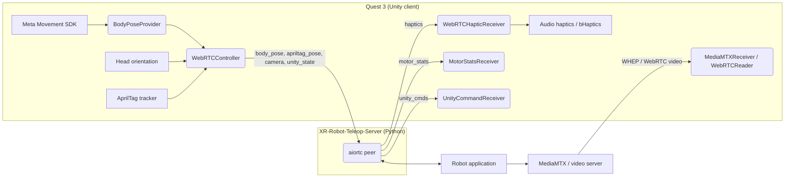

# XR-Robot-Teleop-Client

A Unity (6000.3.11f1) client for VR robot teleoperation on the Meta Quest 3. It streams the operator's upper-body pose and hand data from the headset to a Python peer over WebRTC data channels, and receives stereo or monocular camera video, fingertip haptics, and motor telemetry back.

The Python peer is [`XR-Robot-Teleop-Server`](https://github.com/yunho-c/XR-Robot-Teleop-Server) (aiortc). It answers the client's WebRTC offer and exposes each data channel to user-defined callbacks. Robot-side applications, such as our Unitree G1 teleoperation stack (not public), are built on top of it.

Developed at Georgia Tech in the Robot Danger Lab (RDL) and the Symbiotic & Augmented Intelligence Laboratory (SAIL).

## Features

- Upper-body pose from the Meta Movement SDK, sent over an unreliable, unordered data channel for low latency.
- Two video modes (separate scenes, switchable from the in-VR menu):
  - **FPV Mode** (`ZEDv2.unity`): stereo camera feed received over MediaMTX WHEP and shown in a head-locked viewport.
  - **Webcam Mode** (`MainScene.unity`): Quest passthrough plus a monocular webcam stream, with on-device AprilTag tracking from the passthrough camera.
- Fingertip haptics from the server: audio haptics (always available) and optional bHaptics TactGlove output.
- Motor temperature/torque overlay and server-controlled UI toggles (`unity_cmds`).
- Safety pause: teleop pauses automatically when the headset is removed.
- In-VR menu ("CloverUI") for connecting, starting teleop, entering the server IP, and settings.

## Requirements

| Item | Notes |
| :--- | :--- |
| Unity | 6000.3.11f1, with Android Build Support |
| Headset | Meta Quest 3 (developer mode enabled) |
| Git LFS | Required. Run `git lfs install` **before** cloning |
| Server | [`XR-Robot-Teleop-Server`](https://github.com/yunho-c/XR-Robot-Teleop-Server) on a machine reachable from the headset |
| Video (optional) | A MediaMTX instance for FPV Mode, or a WebSocket-signaled WebRTC video server for Webcam Mode |

### Hardware compatibility

| Device | Status |
| :--- | :--- |
| Meta Quest 3 | Supported |
| Meta Quest Pro | Untested |
| Other headsets | Not supported |

## Build

```bash
git lfs install
git clone https://github.com/Euler-Rodrigues-Lab/XRT-Client.git
cd XRT-Client
git lfs pull
```

1. Open the project in Unity 6000.3.11f1. Packages (Meta XR SDKs, Movement SDK, `com.unity.webrtc`) resolve from `Packages/manifest.json`.
2. Switch the build target to **Android** (File > Build Profiles).
3. Build scenes, in order, are `ZEDv2` (index 0, the startup scene), `MainScene`, and `ZED` (an older prototype scene that lacks the haptics, motor-stats, and command receivers).
4. Set your own signing keystore under Player Settings > Publishing Settings. Keystores (`*.keystore`, `*.jks`) and APKs are gitignored; never commit them.
5. Build and run, or build an APK.

### Optional proprietary SDKs

These SDKs are not in the repository and cannot be redistributed. The project compiles and runs without them; audio haptics still work.

| SDK | Import into | Source |
| :--- | :--- | :--- |
| bHaptics SDK2 | `Assets/Bhaptics/` | Unity Asset Store ("bHaptics Haptic Plugin") or the bHaptics developer portal |
| SenseGlove Unity plugin (experimental integration) | `Assets/SenseGlove/` | https://github.com/Adjuvo/SenseGlove-Unity |

`Assets/Editor/OptionalSdkDefines/OptionalSdkDefines.cs` detects the SDKs on every editor load and whenever files matching `Bhaptics` or `SenseGlove` are imported, moved, or deleted. It writes `-define:XRT_BHAPTICS` and/or `-define:XRT_SENSEGLOVE` into `Assets/csc.rsp` (gitignored, machine-local) and requests a recompile. To force a re-check, use **Tools > XRT > Refresh Optional SDK Defines**.

- bHaptics is detected by `BhapticsLibrary.cs` and `BhapticsPhysicsGlove.cs`; SenseGlove by `SG_TrackedHand.cs`, `SG_HapticGlove.cs`, and `Plugins/Android/SGCoreCs.dll`.
- Until an SDK is imported, scene components that reference it show as "Missing Script" in the Inspector. This is expected.
- Unity will not save a prefab that contains a missing script, so editing `Assets/[BB] Interaction Rig.prefab` and the `Assets/Export/` hand prefabs requires the bHaptics SDK to be imported.
- If you remove an SDK while Unity is closed, delete `Assets/csc.rsp` before reopening the project (otherwise its define is still set and compilation fails).

### Samples not committed

The Meta XR Interaction SDK and WebRTC package samples are gitignored. Re-import them from Package Manager > Samples if you need them. The Meta XR Movement SDK samples are committed because the scenes use their character assets (Oculus SDK License).

## Usage

1. Install the APK on the Quest, either with [Meta Quest Developer Hub](https://developers.meta.com/horizon/documentation/unity/ts-mqdh/) (Devices tab, drag and drop the `.apk`) or:
   ```bash
   adb install -r <your-build>.apk
   ```
2. Start the server application built on `XR-Robot-Teleop-Server`. The client POSTs its SDP offer to `http://<server>:8080/offer`.
3. In VR, open the **IP Address** panel and enter the server IP. A raw IP is recommended over a hostname for a faster first connect. Server addresses persist in `PlayerPrefs`.
4. Press **Power** to connect.
5. Press **Play** to start teleoperation. Press it again to pause.

If the headset and server are on different networks, use a VPN such as Tailscale or set up port forwarding. The headset needs to reach the signaling port (8080) and the video ports.

### Using the stock `xr-robot-teleop-server` examples

The client is wire-compatible with the public [`xr-robot-teleop-server`](https://pypi.org/project/xr-robot-teleop-server/) package (`pip install xr-robot-teleop-server`) and its examples (e.g. `visualize_body_pose.py`, `record_body_pose.py`, the robosuite/MuJoCo demo). The `body_pose` binary format, the `camera` head-orientation channel and the default `:8080/offer` endpoint are unchanged. A few behaviours differ from the original client, so:

- **Pose only streams after you press Play.** Power connects; Play starts streaming `body_pose` (the original client streamed as soon as it connected). If the server example shows no motion after connecting, press Play.
- **Server-sent video appears in Webcam Mode.** If your server provides a video track (its `video_track_factory`, e.g. a 360° camera source rendered from the `camera` head orientation), switch to **Webcam Mode** and turn on **Streaming Features > Toggle Video Display**. FPV Mode (the startup scene) does not request video from this server; it uses MediaMTX instead.
- **Extra channels are harmless.** The client also opens `unity_state`, `unity_cmds`, `haptics`, `motor_stats` and `apriltag_pose`; a stock server just logs "No handler registered for data channel" for any it doesn't use.

### In-VR menu

| Control | Function |
| :--- | :--- |
| Power | Connect to the server (connect only; does not move the robot) |
| Play / Pause | Engage or pause teleoperation |
| IP Address | Set the server address |
| Streaming connection | Connect or disconnect the video feed |
| Features / Settings | Haptics toggles, avatar overlay, world-lock, and display options |
| Webcam Mode / FPV Mode | Switch between `MainScene` and `ZEDv2` |

### Safety

On `OVRManager.HMDUnmounted` (and as a backstop on `OnApplicationPause`), `WebRTCController` stops pose streaming and reports `teleop_active=false` on `unity_state`, retrying until the report is sent. Teleop stays paused after re-donning until you press Play (or the server resumes it).

## Video

| Mode | Scene | Transport | Default address |
| :--- | :--- | :--- | :--- |
| FPV | `ZEDv2.unity` | MediaMTX WHEP (`MediaMTXReceiver.cs`) | `<server>:8889/zed_stereo` (single side-by-side stream) |
| Webcam | `MainScene.unity` | WebRTC with WebSocket signaling (`WebRTCReader.cs`) | `ws://<server>:3000/ws` |

- In FPV Mode the video host is derived from the teleop server IP as `<host>:8889/zed_stereo` unless you override the video address manually. A two-stream (left/right) mode exists but is off by default.
- FPV Mode renders the feed in a head-locked viewport with FOV fill and alignment tools (`ZEDFOVFiller.cs`, `VideoRepositionPanel.cs`).
- Webcam Mode uses AprilTag detection on the Quest passthrough camera (`QuestAprilTagTracker.cs`, `QuestCameraExtractor.cs`, native `libapriltag.so` in `Assets/Plugins/Android/arm64-v8a/`) and sends results on `apriltag_pose`.

## Data channels

The Quest creates all channels in `WebRTCController.StartWebRTC`; the server receives them through its data-channel handler. Video tracks are received on a receive-only transceiver when video is enabled.

| Channel | Direction | Reliability | Purpose |
| :--- | :--- | :--- | :--- |
| `body_pose` | Quest to server | Unreliable, unordered | Binary upper-body and hand pose |
| `apriltag_pose` | Quest to server | Unreliable, unordered | Binary AprilTag poses (Webcam Mode) |
| `camera` | Quest to server | Reliable, ordered | JSON head orientation (yaw, pitch, roll) |
| `unity_state` | Quest to server | Reliable, unordered | JSON UI/teleop state, e.g. `teleop_active` |
| `haptics` | Server to Quest | Unreliable, unordered | Fingertip haptic samples |
| `motor_stats` | Server to Quest | Unreliable, unordered | Motor temperature/torque telemetry |
| `unity_cmds` | Server to Quest | Reliable, unordered | Commands: `toggle_audio_haptics`, `toggle_vibrotactile_haptics`, `show_streaming_viewport`, `toggle_streaming_connection`, `teleop_active`, `latency_ping` |

## Theory of operation



## Status and contributing

Research code, tested on Quest 3. Issues and pull requests are welcome.

## License and third-party components

Released under the MIT License (see `LICENSE`). Third-party components and their licenses are listed in [THIRD_PARTY_NOTICES.md](THIRD_PARTY_NOTICES.md). Meta SDK assets are used under the Oculus SDK License; bHaptics and SenseGlove SDKs are not included.

## Credits

Original author: Yunho Cho. Contributors: Austin Graves, Chuizheng Kong, Sundhar Vinodh Sangeetha, mjaychoi, and iaweebowo.

This repository is a clean re-publication of the project's earlier development history (originally at `yunho-c/XRT-Client`), with third-party SDK code removed.

## Collaboration: Unity YAML merge

Unity scenes and prefabs merge poorly as plain text. Configure UnityYAMLMerge as the merge tool:

Typical location of UnityYAMLMerge:

- Windows: `C:\Program Files\Unity\Hub\Editor\<version>\Editor\Data\Tools\UnityYAMLMerge.exe`
- macOS: `~/Documents/Unity/<version>/Contents/Tools/UnityYAMLMerge`
- Linux: `<Unity install>/Editor/Data/Tools/UnityYAMLMerge`

```bash
git config merge.tool unityyamlmerge

git config mergetool.unityyamlmerge.cmd '<UnityYAMLMerge_path> merge -p "$BASE" "$REMOTE" "$LOCAL" "$MERGED"'

git config mergetool.unityyamlmerge.trustExitCode true
```
